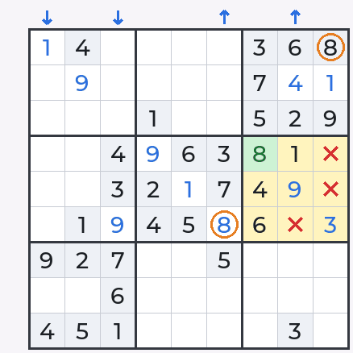

<!-- Written by tools/walkthrough.py rossini: edit the script, not this page. -->
# Rossini, step 11: the 8 in box 6

**Step 11 of 51** · [← Step 10](step-10.md) · [All steps](../rossini.md#the-whole-puzzle-step-by-step) · [Step 12 →](step-12.md)

Box 6 needs an 8. r4c9 and r5c9: column 9 has one (r1c9). r6c8: row 6 has one (r6c6). Only **r4c7** is left: **r4c7 = 8**.

**Step 11 of 51** · [← Step 10](step-10.md) · [All steps](../rossini.md#the-whole-puzzle-step-by-step) · [Step 12 →](step-12.md)
