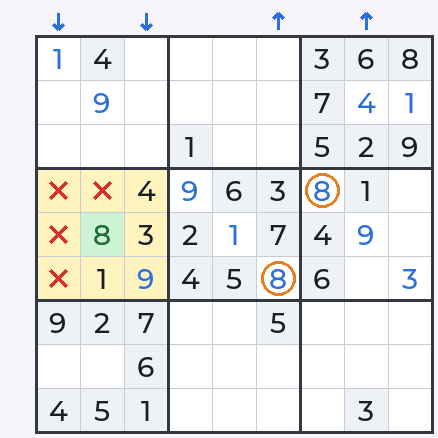

<!-- Written by tools/walkthrough.py rossini: edit the script, not this page. -->
# Rossini, step 12: the 8 in box 4

**Step 12 of 51** · [← Step 11](step-11.md) · [All steps](../rossini.md#the-whole-puzzle-step-by-step) · [Step 13 →](step-13.md)

Box 4 needs an 8. r4c1 and r4c2: row 4 has one (r4c7). r6c1: row 6 has one (r6c6). r5c1: the first three digits of row 5 neither rise nor fall (row 5 has no arrow), and an 8 here can't keep that. Only **r5c2** is left: **r5c2 = 8**.

**Step 12 of 51** · [← Step 11](step-11.md) · [All steps](../rossini.md#the-whole-puzzle-step-by-step) · [Step 13 →](step-13.md)
