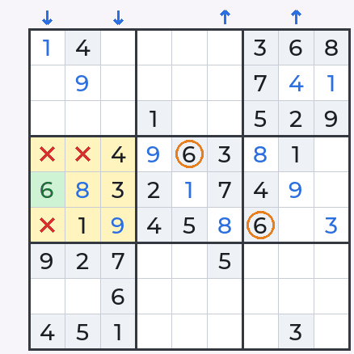

<!-- Written by tools/walkthrough.py rossini: edit the script, not this page. -->
# Rossini, step 13: the 6 in box 4

**Step 13 of 51** · [← Step 12](step-12.md) · [All steps](../rossini.md#the-whole-puzzle-step-by-step) · [Step 14 →](step-14.md)

Box 4 needs a 6. r4c1 and r4c2: row 4 has one (r4c5). r6c1: row 6 has one (r6c7). Only **r5c1** is left: **r5c1 = 6**.

**Step 13 of 51** · [← Step 12](step-12.md) · [All steps](../rossini.md#the-whole-puzzle-step-by-step) · [Step 14 →](step-14.md)
