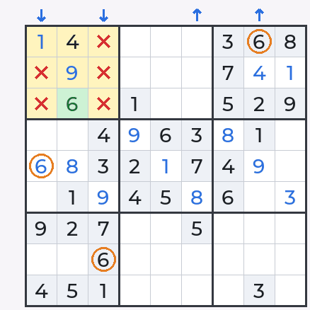

<!-- Written by tools/walkthrough.py rossini: edit the script, not this page. -->
# Rossini, step 14: the 6 in box 1

**Step 14 of 51** · [← Step 13](step-13.md) · [All steps](../rossini.md#the-whole-puzzle-step-by-step) · [Step 15 →](step-15.md)

Box 1 needs a 6. r1c3: row 1 has one (r1c8). r2c1 and r3c1: column 1 has one (r5c1). r2c3 and r3c3: column 3 has one (r8c3). Only **r3c2** is left: **r3c2 = 6**.

**Step 14 of 51** · [← Step 13](step-13.md) · [All steps](../rossini.md#the-whole-puzzle-step-by-step) · [Step 15 →](step-15.md)
