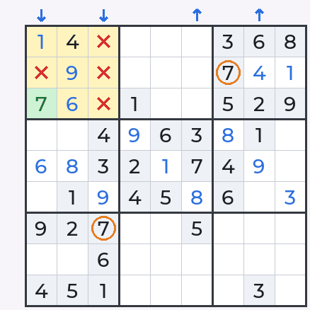

<!-- Written by tools/walkthrough.py rossini: edit the script, not this page. -->
# Rossini, step 15: the 7 in box 1

**Step 15 of 51** · [← Step 14](step-14.md) · [All steps](../rossini.md#the-whole-puzzle-step-by-step) · [Step 16 →](step-16.md)

Box 1 needs a 7. r1c3 and r3c3: column 3 has one (r7c3). r2c1 and r2c3: row 2 has one (r2c7). Only **r3c1** is left: **r3c1 = 7**.

**Step 15 of 51** · [← Step 14](step-14.md) · [All steps](../rossini.md#the-whole-puzzle-step-by-step) · [Step 16 →](step-16.md)
