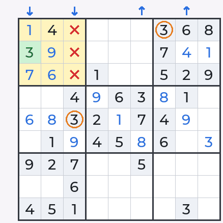

<!-- Written by tools/walkthrough.py rossini: edit the script, not this page. -->
# Rossini, step 16: the 3 in box 1

**Step 16 of 51** · [← Step 15](step-15.md) · [All steps](../rossini.md#the-whole-puzzle-step-by-step) · [Step 17 →](step-17.md)

Box 1 needs a 3. r1c3: row 1 has one (r1c7). r2c3 and r3c3: column 3 has one (r5c3). Only **r2c1** is left: **r2c1 = 3**.

**Step 16 of 51** · [← Step 15](step-15.md) · [All steps](../rossini.md#the-whole-puzzle-step-by-step) · [Step 17 →](step-17.md)
