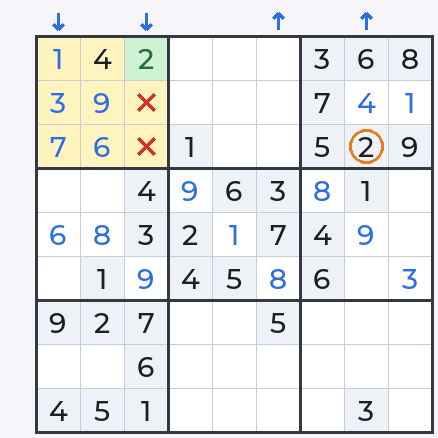

<!-- Written by tools/walkthrough.py rossini: edit the script, not this page. -->
# Rossini, step 17: the 2 in box 1

**Step 17 of 51** · [← Step 16](step-16.md) · [All steps](../rossini.md#the-whole-puzzle-step-by-step) · [Step 18 →](step-18.md)

Box 1 needs a 2. r3c3: row 3 has one (r3c8). r2c3: the first three digits of column 3 rise from the top, and a 2 here can't keep that. Only **r1c3** is left: **r1c3 = 2**.

**Step 17 of 51** · [← Step 16](step-16.md) · [All steps](../rossini.md#the-whole-puzzle-step-by-step) · [Step 18 →](step-18.md)
