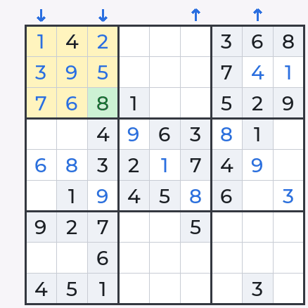

<!-- Written by tools/walkthrough.py rossini: edit the script, not this page. -->
# Rossini, step 19: the 8 in box 1

**Step 19 of 51** · [← Step 18](step-18.md) · [All steps](../rossini.md#the-whole-puzzle-step-by-step) · [Step 20 →](step-20.md)

Box 1 needs an 8, and r3c3 is its last empty cell: **r3c3 = 8**.

**Step 19 of 51** · [← Step 18](step-18.md) · [All steps](../rossini.md#the-whole-puzzle-step-by-step) · [Step 20 →](step-20.md)
