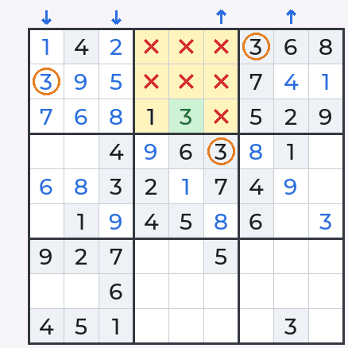

<!-- Written by tools/walkthrough.py rossini: edit the script, not this page. -->
# Rossini, step 20: the 3 in box 2

**Step 20 of 51** · [← Step 19](step-19.md) · [All steps](../rossini.md#the-whole-puzzle-step-by-step) · [Step 21 →](step-21.md)

Box 2 needs a 3. r1c4, r1c5 and r1c6: row 1 has one (r1c7). r2c4, r2c5 and r2c6: row 2 has one (r2c1). r3c6: column 6 has one (r4c6). Only **r3c5** is left: **r3c5 = 3**.

**Step 20 of 51** · [← Step 19](step-19.md) · [All steps](../rossini.md#the-whole-puzzle-step-by-step) · [Step 21 →](step-21.md)
