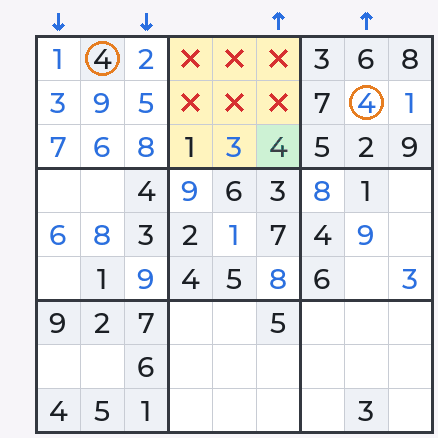

<!-- Written by tools/walkthrough.py rossini: edit the script, not this page. -->
# Rossini, step 21: the 4 in box 2

**Step 21 of 51** · [← Step 20](step-20.md) · [All steps](../rossini.md#the-whole-puzzle-step-by-step) · [Step 22 →](step-22.md)

Box 2 needs a 4. r1c4, r1c5 and r1c6: row 1 has one (r1c2). r2c4, r2c5 and r2c6: row 2 has one (r2c8). Only **r3c6** is left: **r3c6 = 4**.

**Step 21 of 51** · [← Step 20](step-20.md) · [All steps](../rossini.md#the-whole-puzzle-step-by-step) · [Step 22 →](step-22.md)
