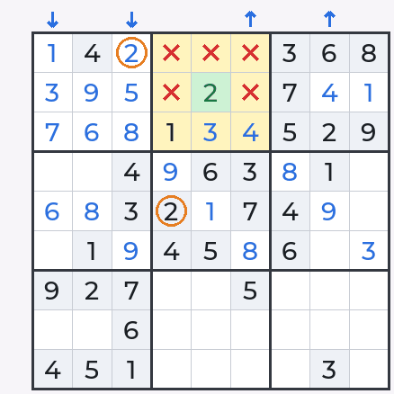

<!-- Written by tools/walkthrough.py rossini: edit the script, not this page. -->
# Rossini, step 22: the 2 in box 2

**Step 22 of 51** · [← Step 21](step-21.md) · [All steps](../rossini.md#the-whole-puzzle-step-by-step) · [Step 23 →](step-23.md)

Box 2 needs a 2. r1c4, r1c5 and r1c6: row 1 has one (r1c3). r2c4: column 4 has one (r5c4). r2c6: the first three digits of column 6 fall from the top, and a 2 here can't keep that. Only **r2c5** is left: **r2c5 = 2**.

**Step 22 of 51** · [← Step 21](step-21.md) · [All steps](../rossini.md#the-whole-puzzle-step-by-step) · [Step 23 →](step-23.md)
