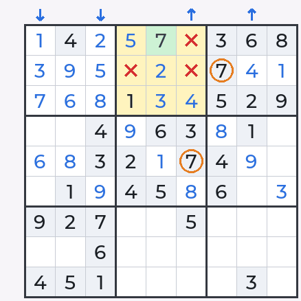

<!-- Written by tools/walkthrough.py rossini: edit the script, not this page. -->
# Rossini, step 24: the 7 in box 2

**Step 24 of 51** · [← Step 23](step-23.md) · [All steps](../rossini.md#the-whole-puzzle-step-by-step) · [Step 25 →](step-25.md)

Box 2 needs a 7. r1c6: column 6 has one (r5c6). r2c4 and r2c6: row 2 has one (r2c7). Only **r1c5** is left: **r1c5 = 7**.

**Step 24 of 51** · [← Step 23](step-23.md) · [All steps](../rossini.md#the-whole-puzzle-step-by-step) · [Step 25 →](step-25.md)
