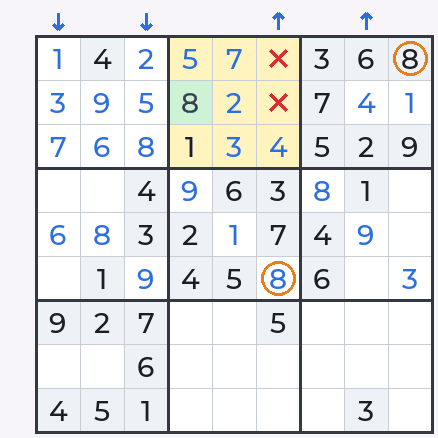

<!-- Written by tools/walkthrough.py rossini: edit the script, not this page. -->
# Rossini, step 25: the 8 in box 2

**Step 25 of 51** · [← Step 24](step-24.md) · [All steps](../rossini.md#the-whole-puzzle-step-by-step) · [Step 26 →](step-26.md)

Box 2 needs an 8. r1c6: row 1 has one (r1c9). r2c6: column 6 has one (r6c6). Only **r2c4** is left: **r2c4 = 8**.

**Step 25 of 51** · [← Step 24](step-24.md) · [All steps](../rossini.md#the-whole-puzzle-step-by-step) · [Step 26 →](step-26.md)
