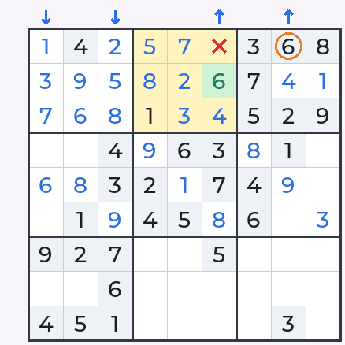

<!-- Written by tools/walkthrough.py rossini: edit the script, not this page. -->
# Rossini, step 26: the 6 in box 2

**Step 26 of 51** · [← Step 25](step-25.md) · [All steps](../rossini.md#the-whole-puzzle-step-by-step) · [Step 27 →](step-27.md)

Box 2 needs a 6. r1c6: row 1 has one (r1c8). Only **r2c6** is left: **r2c6 = 6**.

**Step 26 of 51** · [← Step 25](step-25.md) · [All steps](../rossini.md#the-whole-puzzle-step-by-step) · [Step 27 →](step-27.md)
