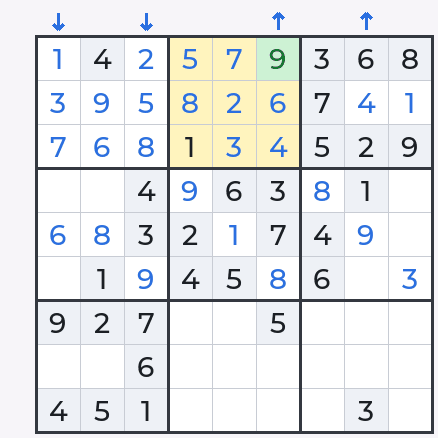

<!-- Written by tools/walkthrough.py rossini: edit the script, not this page. -->
# Rossini, step 27: the 9 in box 2

**Step 27 of 51** · [← Step 26](step-26.md) · [All steps](../rossini.md#the-whole-puzzle-step-by-step) · [Step 28 →](step-28.md)

Box 2 needs a 9, and r1c6 is its last empty cell: **r1c6 = 9**.

**Step 27 of 51** · [← Step 26](step-26.md) · [All steps](../rossini.md#the-whole-puzzle-step-by-step) · [Step 28 →](step-28.md)
