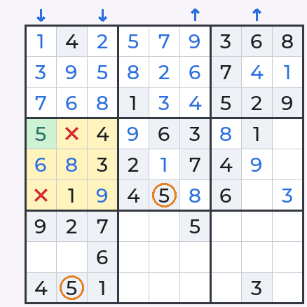

<!-- Written by tools/walkthrough.py rossini: edit the script, not this page. -->
# Rossini, step 28: the 5 in box 4

**Step 28 of 51** · [← Step 27](step-27.md) · [All steps](../rossini.md#the-whole-puzzle-step-by-step) · [Step 29 →](step-29.md)

Box 4 needs a 5. r4c2: column 2 has one (r9c2). r6c1: row 6 has one (r6c5). Only **r4c1** is left: **r4c1 = 5**.

**Step 28 of 51** · [← Step 27](step-27.md) · [All steps](../rossini.md#the-whole-puzzle-step-by-step) · [Step 29 →](step-29.md)
