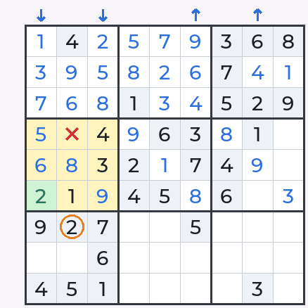

<!-- Written by tools/walkthrough.py rossini: edit the script, not this page. -->
# Rossini, step 29: the 2 in box 4

**Step 29 of 51** · [← Step 28](step-28.md) · [All steps](../rossini.md#the-whole-puzzle-step-by-step) · [Step 30 →](step-30.md)

Box 4 needs a 2. r4c2: column 2 has one (r7c2). Only **r6c1** is left: **r6c1 = 2**.

**Step 29 of 51** · [← Step 28](step-28.md) · [All steps](../rossini.md#the-whole-puzzle-step-by-step) · [Step 30 →](step-30.md)
