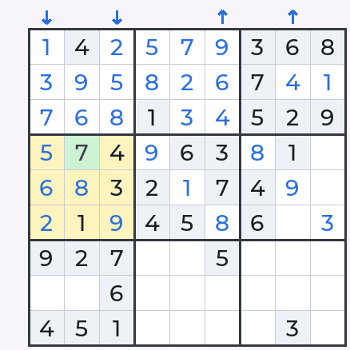

<!-- Written by tools/walkthrough.py rossini: edit the script, not this page. -->
# Rossini, step 30: the 7 in box 4

**Step 30 of 51** · [← Step 29](step-29.md) · [All steps](../rossini.md#the-whole-puzzle-step-by-step) · [Step 31 →](step-31.md)

Box 4 needs a 7, and r4c2 is its last empty cell: **r4c2 = 7**.

**Step 30 of 51** · [← Step 29](step-29.md) · [All steps](../rossini.md#the-whole-puzzle-step-by-step) · [Step 31 →](step-31.md)
