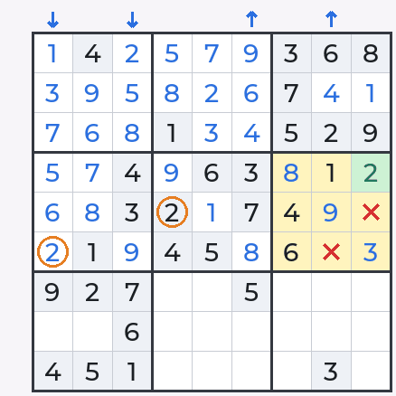

<!-- Written by tools/walkthrough.py rossini: edit the script, not this page. -->
# Rossini, step 31: the 2 in box 6

**Step 31 of 51** · [← Step 30](step-30.md) · [All steps](../rossini.md#the-whole-puzzle-step-by-step) · [Step 32 →](step-32.md)

Box 6 needs a 2. r5c9: row 5 has one (r5c4). r6c8: row 6 has one (r6c1). Only **r4c9** is left: **r4c9 = 2**.

**Step 31 of 51** · [← Step 30](step-30.md) · [All steps](../rossini.md#the-whole-puzzle-step-by-step) · [Step 32 →](step-32.md)
