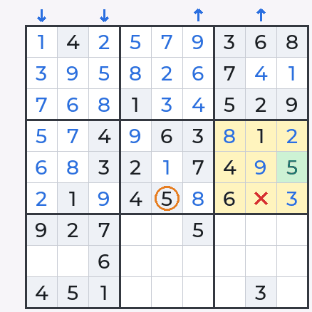

<!-- Written by tools/walkthrough.py rossini: edit the script, not this page. -->
# Rossini, step 32: the 5 in box 6

**Step 32 of 51** · [← Step 31](step-31.md) · [All steps](../rossini.md#the-whole-puzzle-step-by-step) · [Step 33 →](step-33.md)

Box 6 needs a 5. r6c8: row 6 has one (r6c5). Only **r5c9** is left: **r5c9 = 5**.

**Step 32 of 51** · [← Step 31](step-31.md) · [All steps](../rossini.md#the-whole-puzzle-step-by-step) · [Step 33 →](step-33.md)
