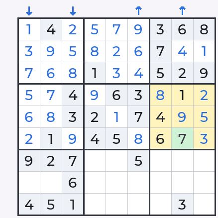

<!-- Written by tools/walkthrough.py rossini: edit the script, not this page. -->
# Rossini, step 33: the 7 in box 6

**Step 33 of 51** · [← Step 32](step-32.md) · [All steps](../rossini.md#the-whole-puzzle-step-by-step) · [Step 34 →](step-34.md)

Box 6 needs a 7, and r6c8 is its last empty cell: **r6c8 = 7**.

**Step 33 of 51** · [← Step 32](step-32.md) · [All steps](../rossini.md#the-whole-puzzle-step-by-step) · [Step 34 →](step-34.md)
