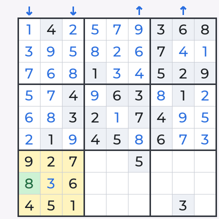

<!-- Written by tools/walkthrough.py rossini: edit the script, not this page. -->
# Rossini, step 35: the 8 in box 7

**Step 35 of 51** · [← Step 34](step-34.md) · [All steps](../rossini.md#the-whole-puzzle-step-by-step) · [Step 36 →](step-36.md)

Box 7 needs an 8, and r8c1 is its last empty cell: **r8c1 = 8**.

**Step 35 of 51** · [← Step 34](step-34.md) · [All steps](../rossini.md#the-whole-puzzle-step-by-step) · [Step 36 →](step-36.md)
