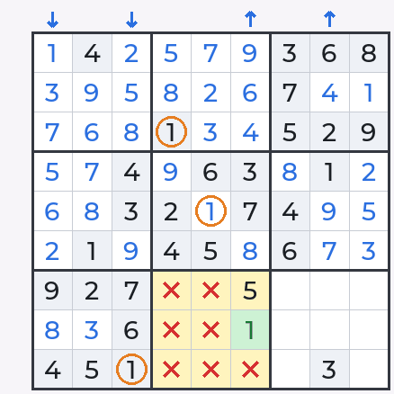

<!-- Written by tools/walkthrough.py rossini: edit the script, not this page. -->
# Rossini, step 36: the 1 in box 8

**Step 36 of 51** · [← Step 35](step-35.md) · [All steps](../rossini.md#the-whole-puzzle-step-by-step) · [Step 37 →](step-37.md)

Box 8 needs a 1. r7c4 and r8c4: column 4 has one (r3c4). r7c5 and r8c5: column 5 has one (r5c5). r9c4, r9c5 and r9c6: row 9 has one (r9c3). Only **r8c6** is left: **r8c6 = 1**.

**Step 36 of 51** · [← Step 35](step-35.md) · [All steps](../rossini.md#the-whole-puzzle-step-by-step) · [Step 37 →](step-37.md)
