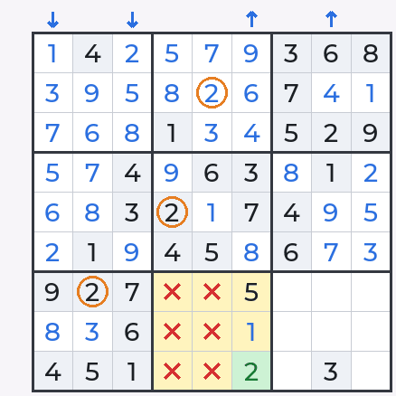

<!-- Written by tools/walkthrough.py rossini: edit the script, not this page. -->
# Rossini, step 37: the 2 in box 8

**Step 37 of 51** · [← Step 36](step-36.md) · [All steps](../rossini.md#the-whole-puzzle-step-by-step) · [Step 38 →](step-38.md)

Box 8 needs a 2. r7c4 and r7c5: row 7 has one (r7c2). r8c4 and r9c4: column 4 has one (r5c4). r8c5 and r9c5: column 5 has one (r2c5). Only **r9c6** is left: **r9c6 = 2**.

**Step 37 of 51** · [← Step 36](step-36.md) · [All steps](../rossini.md#the-whole-puzzle-step-by-step) · [Step 38 →](step-38.md)
