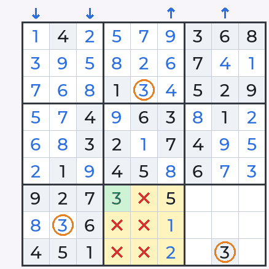

<!-- Written by tools/walkthrough.py rossini: edit the script, not this page. -->
# Rossini, step 38: the 3 in box 8

**Step 38 of 51** · [← Step 37](step-37.md) · [All steps](../rossini.md#the-whole-puzzle-step-by-step) · [Step 39 →](step-39.md)

Box 8 needs a 3. r7c5: column 5 has one (r3c5). r8c4 and r8c5: row 8 has one (r8c2). r9c4 and r9c5: row 9 has one (r9c8). Only **r7c4** is left: **r7c4 = 3**.

**Step 38 of 51** · [← Step 37](step-37.md) · [All steps](../rossini.md#the-whole-puzzle-step-by-step) · [Step 39 →](step-39.md)
