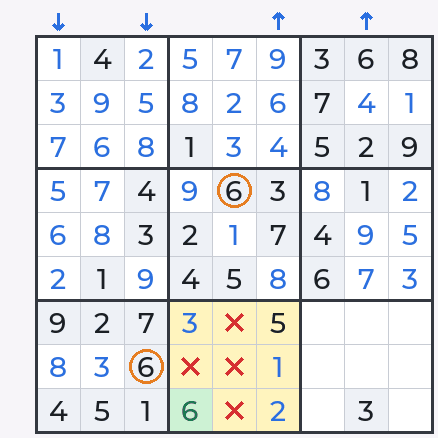

<!-- Written by tools/walkthrough.py rossini: edit the script, not this page. -->
# Rossini, step 39: the 6 in box 8

**Step 39 of 51** · [← Step 38](step-38.md) · [All steps](../rossini.md#the-whole-puzzle-step-by-step) · [Step 40 →](step-40.md)

Box 8 needs a 6. r7c5 and r9c5: column 5 has one (r4c5). r8c4 and r8c5: row 8 has one (r8c3). Only **r9c4** is left: **r9c4 = 6**.

**Step 39 of 51** · [← Step 38](step-38.md) · [All steps](../rossini.md#the-whole-puzzle-step-by-step) · [Step 40 →](step-40.md)
