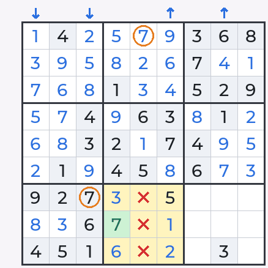

<!-- Written by tools/walkthrough.py rossini: edit the script, not this page. -->
# Rossini, step 40: the 7 in box 8

**Step 40 of 51** · [← Step 39](step-39.md) · [All steps](../rossini.md#the-whole-puzzle-step-by-step) · [Step 41 →](step-41.md)

Box 8 needs a 7. r7c5: row 7 has one (r7c3). r8c5 and r9c5: column 5 has one (r1c5). Only **r8c4** is left: **r8c4 = 7**.

**Step 40 of 51** · [← Step 39](step-39.md) · [All steps](../rossini.md#the-whole-puzzle-step-by-step) · [Step 41 →](step-41.md)
