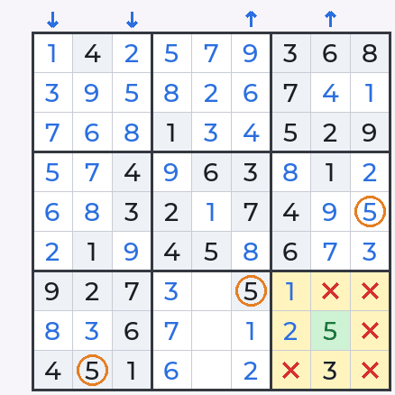

<!-- Written by tools/walkthrough.py rossini: edit the script, not this page. -->
# Rossini, step 43: the 5 in box 9

**Step 43 of 51** · [← Step 42](step-42.md) · [All steps](../rossini.md#the-whole-puzzle-step-by-step) · [Step 44 →](step-44.md)

Box 9 needs a 5. r7c8 and r7c9: row 7 has one (r7c6). r8c9: column 9 has one (r5c9). r9c7 and r9c9: row 9 has one (r9c2). Only **r8c8** is left: **r8c8 = 5**.

**Step 43 of 51** · [← Step 42](step-42.md) · [All steps](../rossini.md#the-whole-puzzle-step-by-step) · [Step 44 →](step-44.md)
