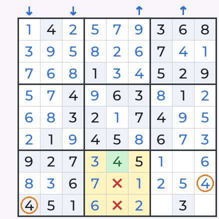

<!-- Written by tools/walkthrough.py rossini: edit the script, not this page. -->
# Rossini, step 46: the 4 in box 8

**Step 46 of 51** · [← Step 45](step-45.md) · [All steps](../rossini.md#the-whole-puzzle-step-by-step) · [Step 47 →](step-47.md)

Box 8 needs a 4. r8c5: row 8 has one (r8c9). r9c5: row 9 has one (r9c1). Only **r7c5** is left: **r7c5 = 4**.

**Step 46 of 51** · [← Step 45](step-45.md) · [All steps](../rossini.md#the-whole-puzzle-step-by-step) · [Step 47 →](step-47.md)
