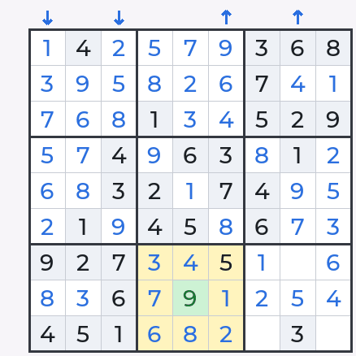

<!-- Written by tools/walkthrough.py rossini: edit the script, not this page. -->
# Rossini, step 48: the 9 in box 8

**Step 48 of 51** · [← Step 47](step-47.md) · [All steps](../rossini.md#the-whole-puzzle-step-by-step) · [Step 49 →](step-49.md)

Box 8 needs a 9, and r8c5 is its last empty cell: **r8c5 = 9**.

**Step 48 of 51** · [← Step 47](step-47.md) · [All steps](../rossini.md#the-whole-puzzle-step-by-step) · [Step 49 →](step-49.md)
