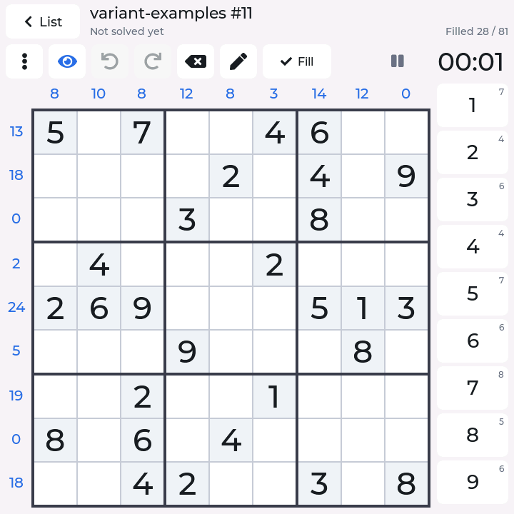

# Sandwich

[← All variants](README.md) · [Puzzles](../features-puzzles.md) · [How to play](../how-to-play.md)



## The rules

[Classic](classic.md) rules, and a number **left of each row** and **above each column**: the sum of the digits **between that line's 1 and its 9**, wherever they are and whichever comes first. A 0 means the 1 and the 9 are side by side.

## On the board

- The sums are in blue in a margin above and left of the board (the board is a little smaller to make room).
- Between a 1 and a 9 that add up to more than the sum, or, once filled, to anything else, the digits turn red.
- The grader and hints work out where a line's 1 and 9 can stand: "the 9 fewer places there".
- **Puzzles → ⋮ → New puzzle → Sandwich**.

## How to solve it

- **0:** the 1 and the 9 touch. Once one of them is placed, the other is right next to it.
- **35:** every digit from 2 to 8 is between them, so the 1 and the 9 are at the two ends of the line.
- **Small sums fix the gap:** the 1 is an end, so the digits between are 2 to 8. A sum of 2, 3 or 4 is that one digit alone; 5 is a single 5 or 2 + 3; 9 is two digits (2 + 7, 3 + 6, 4 + 5) or three (2 + 3 + 4). Small and very big sums leave few gap lengths.
- **Once the 1 is placed**, try each place for the 9: the cells between must be able to make the sum with the digits the line still has. Usually only one or two places work, as in the worked example.

## Worked example

**variant-examples #11**, Sandwich Easy (see [Classic](classic.md#worked-example) for how to import the examples; cells are written r*row*c*column*). The sums are in the screenshot: rows 13, 18, 0, 2, 24, 5, 19, 0, 18 from the top; columns 8, 10, 8, 12, 8, 3, 14, 12, 0 from the left.

```
5 . 7 | . . 4 | 6 . .
. . . | . 2 . | 4 . 9
. . . | 3 . . | 8 . .
------+-------+------
. 4 . | . . 2 | . . .
2 6 9 | . . . | 5 1 3
. . . | 9 . . | . 8 .
------+-------+------
. . 2 | . . 1 | . . .
8 . 6 | . 4 . | . . .
. . 4 | 2 . . | 3 . 8
```

**Step 1: r7c7, next to row 7's 1.** Row 7 has 2 and 1; column 7 has 6, 4, 8, 5 and 3; box 9 has 3 and 8. By the Classic rules r7c7 could be 7 or 9. But row 7's 1 is in r7c6, right next to it: a 9 there would make row 7's sandwich 0, and its sum is **19**. **r7c7 = 7**.

**Step 2: the 9 in column 6 (sum 3).** Column 6's 1 is in r7c6. The digits between it and the 9 must add up to **3**. Where can the 9 go?

- r8c6, right below the 1: the sum would be 0.
- r9c6, two below: the one cell between, r8c6, would have to be 3. Possible.
- r6c6, r5c6, r2c6: rows 6, 5 and 2 already have a 9.
- r3c6: between it and the 1 are r4c6 (a 2), r5c6 and r6c6: at least 2 + 3 + 4 = 9, too much.
- r1c6 and r4c6 are filled.

**r9c6 = 9**.

**Step 3: r8c6, the filling.** r8c6 is now the only cell between column 6's 1 (r7c6) and 9 (r9c6), so it's the whole sum: **r8c6 = 3**.

Row 8's sum is 0 too, so its 1 and 9 touch; with the 3 in place, that's the next thing to look at.
