# Sandwich

[← All variants](README.md) · [Puzzles](../features-puzzles.md) · [How to play](../how-to-play.md)

## The rules

[Classic](classic.md) rules, and a number **left of each row** and **above each column**: the sum of the digits **between that line's 1 and its 9**, wherever they are and whichever comes first. A 0 means the 1 and the 9 are side by side.

## On the board

- The sums are in blue in a margin above and left of the board (the board is a little smaller to make room).
- Between a 1 and a 9 that add up to more than the sum, or, once filled, to anything else, the digits turn red.
- The grader and hints work out where a line's 1 and 9 can stand: "the 9 fewer places there".
- **Puzzles → ⋮ → New puzzle → Sandwich**.

## How to solve it

- **0:** the 1 and the 9 touch. Once one of them is placed, the other is right next to it.
- **35:** every digit from 2 to 8 is between them, so the 1 and the 9 are at the two ends of the line.
- **Small sums fix the gap:** the 1 is an end, so the digits between are 2 to 8. A sum of 2, 3 or 4 is that one digit alone; 5 is a single 5 or 2 + 3; 9 is two digits (2 + 7, 3 + 6, 4 + 5) or three (2 + 3 + 4). Small and very big sums leave few gap lengths.
- **Once the 1 is placed**, try each place for the 9: the cells between must be able to make the sum with the digits the line still has. Usually only one or two places work, as in the worked example.

## Worked example

**variant-examples #11**, Sandwich Easy (see [Classic](classic.md#worked-example-the-whole-puzzle) for how to import the examples; cells are written r*row*c*column*). The sums are in the screenshot: rows 13, 18, 0, 2, 24, 5, 19, 0, 18 from the top; columns 8, 10, 8, 12, 8, 3, 14, 12, 0 from the left.

**Step 1: r7c7, next to row 7's 1.** Row 7 has 2 and 1; column 7 has 6, 4, 8, 5 and 3; box 9 has 3 and 8. By the Classic rules r7c7 could be 7 or 9. But row 7's 1 is in r7c6, right next to it: a 9 there would make row 7's sandwich 0, and its sum is **19**. **r7c7 = 7**.

**Step 2: the 9 in column 6 (sum 3).** Column 6's 1 is in r7c6. The digits between it and the 9 must add up to **3**. Where can the 9 go?

- r8c6, right below the 1: the sum would be 0.
- r9c6, two below: the one cell between, r8c6, would have to be 3. Possible.
- r6c6, r5c6, r2c6: rows 6, 5 and 2 already have a 9.
- r3c6: between it and the 1 are r4c6 (a 2), r5c6 and r6c6: at least 2 + 3 + 4 = 9, too much.
- r1c6 and r4c6 are filled.

**r9c6 = 9**.

**Step 3: r8c6, the filling.** r8c6 is now the only cell between column 6's 1 (r7c6) and 9 (r9c6), so it's the whole sum: **r8c6 = 3**.

Row 8's sum is 0 too, so its 1 and 9 touch; with the 3 in place, that's the next thing to look at.

## The whole puzzle, step by step

<!-- walkthrough -->
<!-- Written by tools/walkthrough.py sandwich: edit the script, not this part. -->

The whole puzzle, from the start to the last cell: 53 steps, each one a single (one place left for a digit, or one digit left for a cell), taken in the order a box's single comes first, so not quite the order of the worked example above. In each picture, the unit the step looks at is tinted yellow (for a cell with one digit left: its row, column and box), the new digit is on green, the digits that rule cells out have an **orange ring**, and the empty cells they rule out a **red cross**. Givens are on grey, digits from earlier steps in blue.

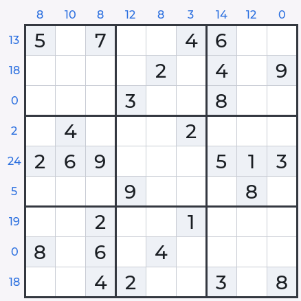

#### Step 1: the 4 in box 1

Box 1 needs a 4. r1c2: row 1 has one (r1c6). r2c1, r2c2 and r2c3: row 2 has one (r2c7). r3c2: column 2 has one (r4c2). r3c3: column 3 has one (r9c3). Only **r3c1** is left: **r3c1 = 4**.

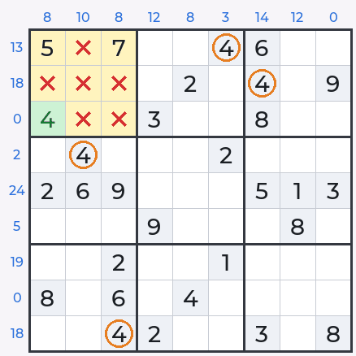

#### Step 2: the 6 in box 1

Box 1 needs a 6. r1c2: row 1 has one (r1c7). r2c2 and r3c2: column 2 has one (r5c2). r2c3 and r3c3: column 3 has one (r8c3). Only **r2c1** is left: **r2c1 = 6**.

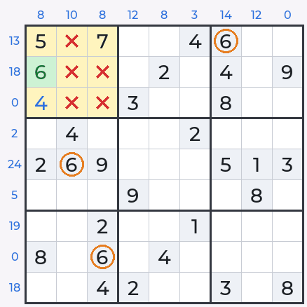

#### Step 3: the 8 in box 4

Box 4 needs an 8. r4c1: column 1 has one (r8c1). r6c1, r6c2 and r6c3: row 6 has one (r6c8). Only **r4c3** is left: **r4c3 = 8**.

#### Step 4: the 1 in box 5

Box 5 needs a 1. r5c4, r5c5 and r5c6: row 5 has one (r5c8). r6c6: column 6 has one (r7c6). r4c4: column 4's sum is 12: with a 1 there, the digits between its 1 and 9 can't add up to it. r6c5: row 6's sum is 5: with a 1 there, the digits between its 1 and 9 can't add up to it. Only **r4c5** is left: **r4c5 = 1**.

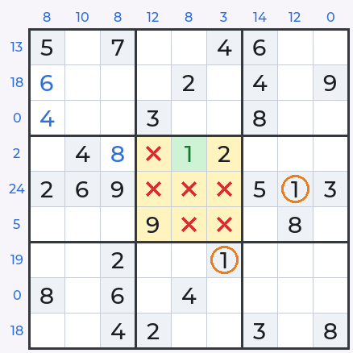

#### Step 5: the 9 in box 2

Box 2 needs a 9. r1c4: column 4 has one (r6c4). r2c4 and r2c6: row 2 has one (r2c9). r3c5: column 5's sum is 8: with a 9 there, the digits between its 1 and 9 can't add up to it. r3c6: column 6's sum is 3: with a 9 there, the digits between its 1 and 9 can't add up to it. Only **r1c5** is left: **r1c5 = 9**.

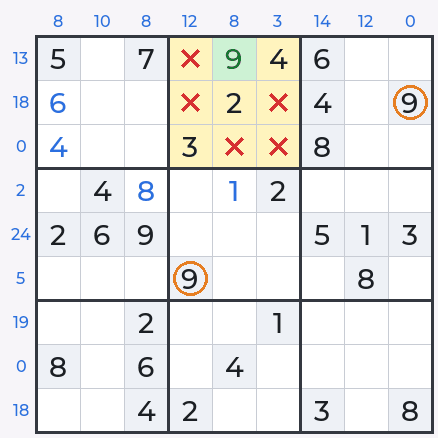

#### Step 6: the 9 in box 1

Box 1 needs a 9. r1c2: row 1 has one (r1c5). r2c2 and r2c3: row 2 has one (r2c9). r3c3: column 3 has one (r5c3). Only **r3c2** is left: **r3c2 = 9**.

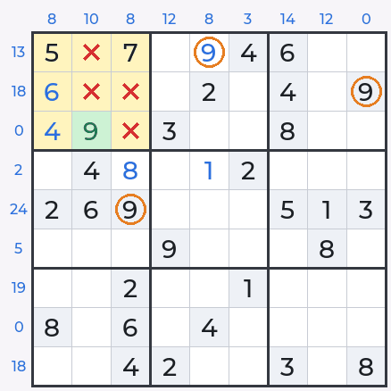

#### Step 7: the 1 in box 1

Box 1 needs a 1. r1c2: column 2's sum is 10: with a 1 there, the digits between its 1 and 9 can't add up to it. r2c2: row 2's sum is 18: with a 1 there, the digits between its 1 and 9 can't add up to it. r2c3: column 3's sum is 8: with a 1 there, the digits between its 1 and 9 can't add up to it. Only **r3c3** is left: **r3c3 = 1**.

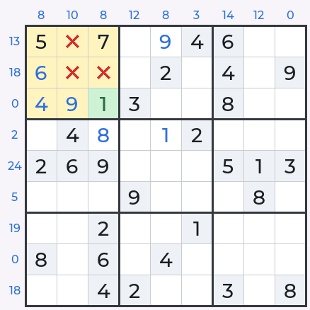

#### Step 8: the 2 in box 1

Box 1 needs a 2. r2c2 and r2c3: row 2 has one (r2c5). Only **r1c2** is left: **r1c2 = 2**.

#### Step 9: the 8 in box 1

Box 1 needs an 8. r2c3: column 3 has one (r4c3). Only **r2c2** is left: **r2c2 = 8**.

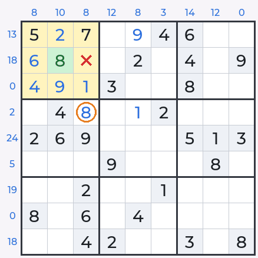

#### Step 10: the 3 in box 1

Box 1 needs a 3, and r2c3 is its last empty cell: **r2c3 = 3**.

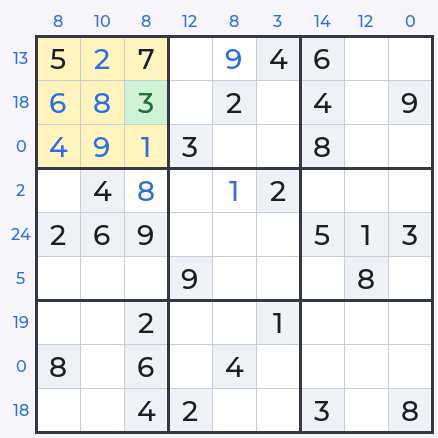

#### Step 11: the 1 in box 2

Box 2 needs a 1. r2c6: column 6 has one (r7c6). r3c5 and r3c6: row 3 has one (r3c3). r1c4: row 1's sum is 13: with a 1 there, the digits between its 1 and 9 can't add up to it. Only **r2c4** is left: **r2c4 = 1**.

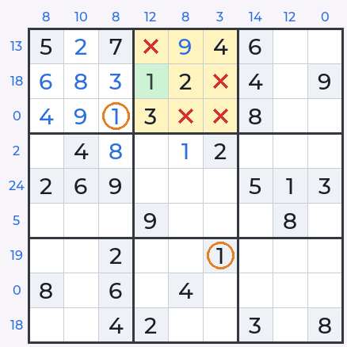

#### Step 12: the 8 in box 2

Box 2 needs an 8. r2c6: row 2 has one (r2c2). r3c5 and r3c6: row 3 has one (r3c7). Only **r1c4** is left: **r1c4 = 8**.

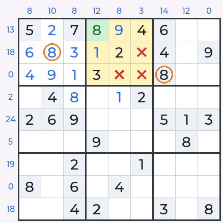

#### Step 13: the 1 in box 3

Box 3 needs a 1. r1c8: column 8 has one (r5c8). r2c8: row 2 has one (r2c4). r3c8 and r3c9: row 3 has one (r3c3). Only **r1c9** is left: **r1c9 = 1**.

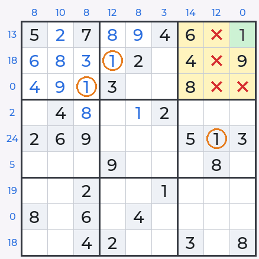

#### Step 14: the 3 in box 3

Box 3 needs a 3. r2c8: row 2 has one (r2c3). r3c8 and r3c9: row 3 has one (r3c4). Only **r1c8** is left: **r1c8 = 3**.

#### Step 15: the 4 in box 5

Box 5 needs a 4. r4c4: row 4 has one (r4c2). r5c5 and r6c5: column 5 has one (r8c5). r5c6 and r6c6: column 6 has one (r1c6). Only **r5c4** is left: **r5c4 = 4**.

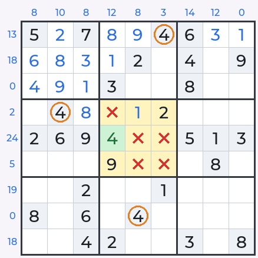

#### Step 16: the 4 in box 6

Box 6 needs a 4. r4c7, r4c8 and r4c9: row 4 has one (r4c2). r6c7: column 7 has one (r2c7). Only **r6c9** is left: **r6c9 = 4**.

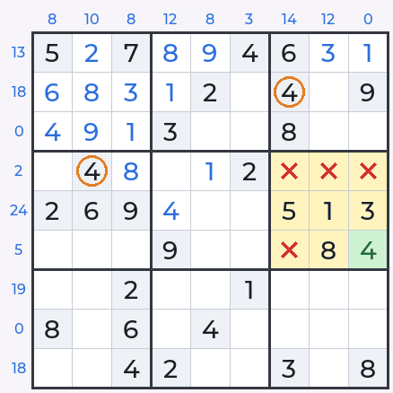

#### Step 17: the 2 in box 6

Box 6 needs a 2. r4c7, r4c8 and r4c9: row 4 has one (r4c6). Only **r6c7** is left: **r6c7 = 2**.

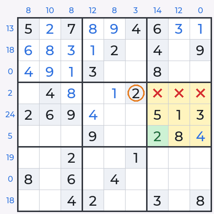

#### Step 18: the 9 in box 6

Box 6 needs a 9. r4c9: column 9 has one (r2c9). r4c8: row 4's sum is 2: with a 9 there, the digits between its 1 and 9 can't add up to it. Only **r4c7** is left: **r4c7 = 9**.

#### Step 19: the 1 in box 7

Box 7 needs a 1. r7c1 and r7c2: row 7 has one (r7c6). r8c2 and r9c2: column 2's sum is 10: with a 1 there, the digits between its 1 and 9 can't add up to it. Only **r9c1** is left: **r9c1 = 1**.

#### Step 20: the 1 in box 4

Box 4 needs a 1. r4c1: row 4 has one (r4c5). r6c1: column 1 has one (r9c1). r6c3: column 3 has one (r3c3). Only **r6c2** is left: **r6c2 = 1**.

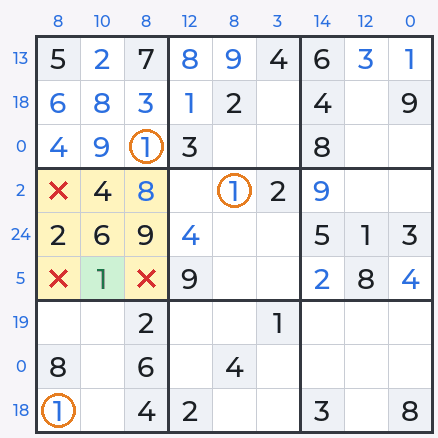

#### Step 21: the 5 in box 4

Box 4 needs a 5. r4c1 and r6c1: column 1 has one (r1c1). Only **r6c3** is left: **r6c3 = 5**.

#### Step 22: the 5 in box 5

Box 5 needs a 5. r5c5 and r5c6: row 5 has one (r5c7). r6c5 and r6c6: row 6 has one (r6c3). Only **r4c4** is left: **r4c4 = 5**.

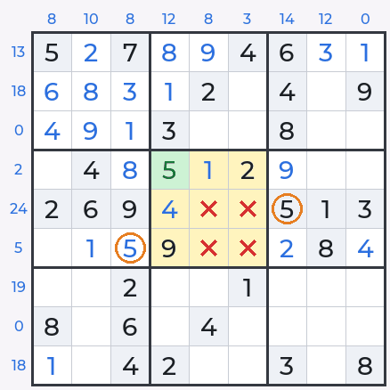

#### Step 23: the 9 in box 7

Box 7 needs a 9. r7c2, r8c2 and r9c2: column 2 has one (r3c2). Only **r7c1** is left: **r7c1 = 9**.

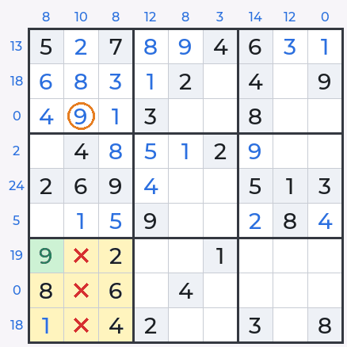

#### Step 24: the 8 in box 8

Box 8 needs an 8. r7c4: column 4 has one (r1c4). r8c4 and r8c6: row 8 has one (r8c1). r9c5 and r9c6: row 9 has one (r9c9). Only **r7c5** is left: **r7c5 = 8**.

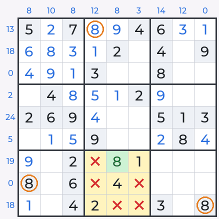

#### Step 25: the 8 in box 5

Box 5 needs an 8. r5c5: column 5 has one (r7c5). r6c5 and r6c6: row 6 has one (r6c8). Only **r5c6** is left: **r5c6 = 8**.

#### Step 26: the 3 in box 8

Box 8 needs a 3. r7c4 and r8c4: column 4 has one (r3c4). r9c5 and r9c6: row 9 has one (r9c7). Only **r8c6** is left: **r8c6 = 3**.

#### Step 27: the 3 in box 5

Box 5 needs a 3. r5c5: row 5 has one (r5c9). r6c6: column 6 has one (r8c6). Only **r6c5** is left: **r6c5 = 3**.

#### Step 28: the 3 in box 4

Box 4 needs a 3. r6c1: row 6 has one (r6c5). Only **r4c1** is left: **r4c1 = 3**.

#### Step 29: the 7 in box 4

Box 4 needs a 7, and r6c1 is its last empty cell: **r6c1 = 7**.

#### Step 30: the 6 in box 5

Box 5 needs a 6. r5c5: row 5 has one (r5c2). Only **r6c6** is left: **r6c6 = 6**.

#### Step 31: the 6 in box 2

Box 2 needs a 6. r2c6: row 2 has one (r2c1). r3c6: column 6 has one (r6c6). Only **r3c5** is left: **r3c5 = 6**.

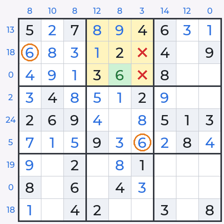

#### Step 32: the 7 in box 5

Box 5 needs a 7, and r5c5 is its last empty cell: **r5c5 = 7**.

#### Step 33: the 3 in box 7

Box 7 needs a 3. r8c2: row 8 has one (r8c6). r9c2: row 9 has one (r9c7). Only **r7c2** is left: **r7c2 = 3**.

#### Step 34: the 6 in box 8

Box 8 needs a 6. r8c4: row 8 has one (r8c3). r9c5: column 5 has one (r3c5). r9c6: column 6 has one (r6c6). Only **r7c4** is left: **r7c4 = 6**.

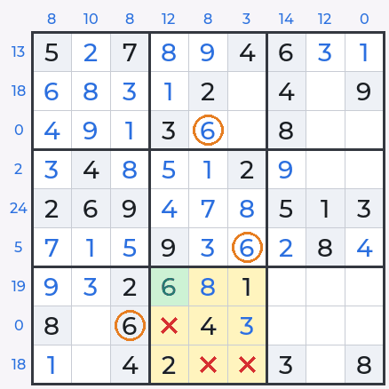

#### Step 35: the 9 in box 8

Box 8 needs a 9. r8c4: column 4 has one (r6c4). r9c5: column 5 has one (r1c5). Only **r9c6** is left: **r9c6 = 9**.

#### Step 36: the 5 in box 8

Box 8 needs a 5. r8c4: column 4 has one (r4c4). Only **r9c5** is left: **r9c5 = 5**.

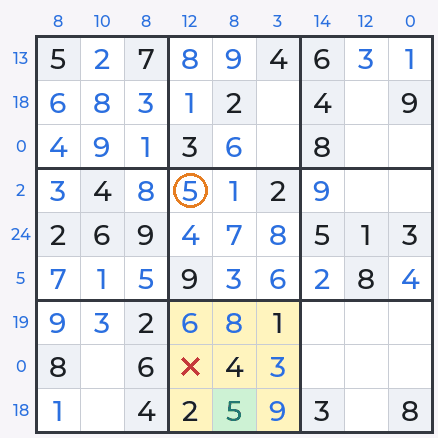

#### Step 37: the 5 in box 7

Box 7 needs a 5. r9c2: row 9 has one (r9c5). Only **r8c2** is left: **r8c2 = 5**.

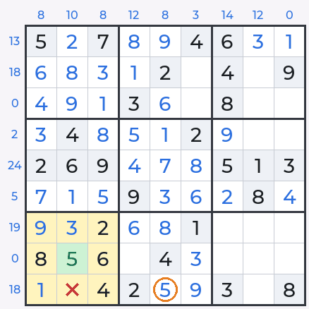

#### Step 38: the 7 in box 7

Box 7 needs a 7, and r9c2 is its last empty cell: **r9c2 = 7**.

#### Step 39: the 7 in box 8

Box 8 needs a 7, and r8c4 is its last empty cell: **r8c4 = 7**.

#### Step 40: the 1 in box 9

Box 9 needs a 1. r7c7, r7c8 and r7c9: row 7 has one (r7c6). r8c8: column 8 has one (r5c8). r8c9: column 9 has one (r1c9). r9c8: row 9 has one (r9c1). Only **r8c7** is left: **r8c7 = 1**.

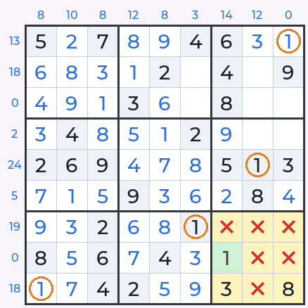

#### Step 41: the 4 in box 9

Box 9 needs a 4. r7c7: column 7 has one (r2c7). r7c9: column 9 has one (r6c9). r8c8 and r8c9: row 8 has one (r8c5). r9c8: row 9 has one (r9c3). Only **r7c8** is left: **r7c8 = 4**.

#### Step 42: the 5 in box 9

Box 9 needs a 5. r7c7: column 7 has one (r5c7). r8c8 and r8c9: row 8 has one (r8c2). r9c8: row 9 has one (r9c5). Only **r7c9** is left: **r7c9 = 5**.

#### Step 43: the 6 in box 9

Box 9 needs a 6. r7c7: row 7 has one (r7c4). r8c8 and r8c9: row 8 has one (r8c3). Only **r9c8** is left: **r9c8 = 6**.

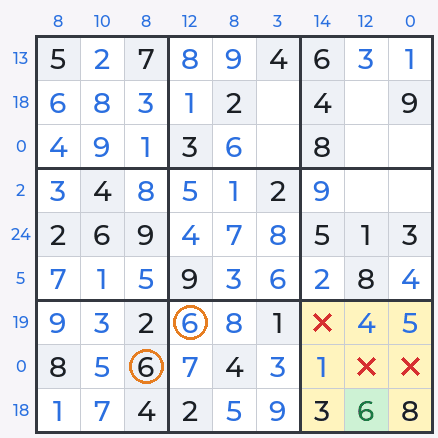

#### Step 44: the 6 in box 6

Box 6 needs a 6. r4c8: column 8 has one (r9c8). Only **r4c9** is left: **r4c9 = 6**.

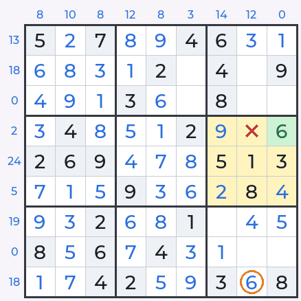

#### Step 45: the 7 in box 6

Box 6 needs a 7, and r4c8 is its last empty cell: **r4c8 = 7**.

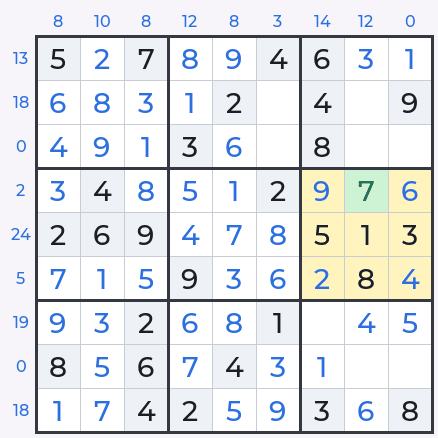

#### Step 46: the 7 in box 3

Box 3 needs a 7. r2c8 and r3c8: column 8 has one (r4c8). Only **r3c9** is left: **r3c9 = 7**.

#### Step 47: the 7 in box 2

Box 2 needs a 7. r3c6: row 3 has one (r3c9). Only **r2c6** is left: **r2c6 = 7**.

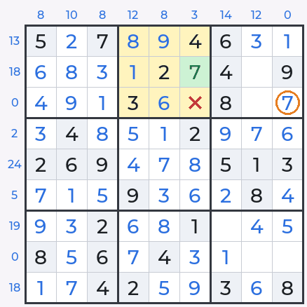

#### Step 48: the 5 in box 2

Box 2 needs a 5, and r3c6 is its last empty cell: **r3c6 = 5**.

#### Step 49: the 2 in box 3

Box 3 needs a 2. r2c8: row 2 has one (r2c5). Only **r3c8** is left: **r3c8 = 2**.

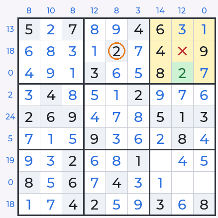

#### Step 50: the 5 in box 3

Box 3 needs a 5, and r2c8 is its last empty cell: **r2c8 = 5**.

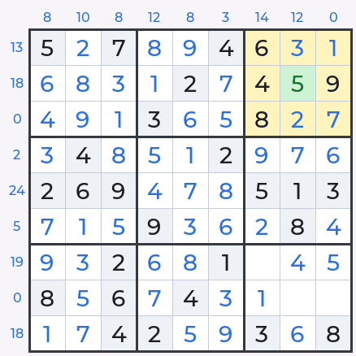

#### Step 51: the 2 in box 9

Box 9 needs a 2. r7c7: row 7 has one (r7c3). r8c8: column 8 has one (r3c8). Only **r8c9** is left: **r8c9 = 2**.

#### Step 52: the 7 in box 9

Box 9 needs a 7. r8c8: row 8 has one (r8c4). Only **r7c7** is left: **r7c7 = 7**.

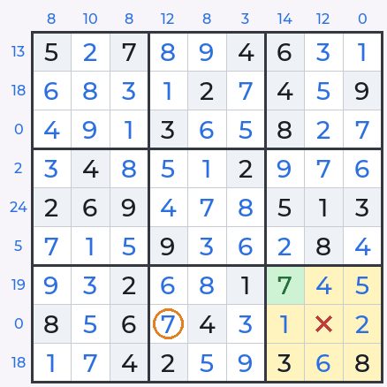

#### Step 53: the 9 in box 9

Box 9 needs a 9, and r8c8 is its last empty cell: **r8c8 = 9**.

Solved.

<!-- /walkthrough -->
