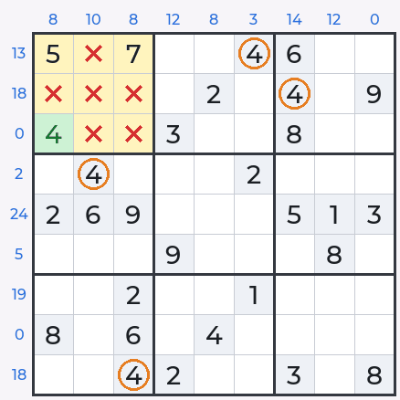

<!-- Written by tools/walkthrough.py sandwich: edit the script, not this page. -->
# Sandwich, step 1: the 4 in box 1

**Step 1 of 53** · [← The start](../sandwich.md#the-whole-puzzle-step-by-step) · [All steps](../sandwich.md#the-whole-puzzle-step-by-step) · [Step 2 →](step-02.md)

Box 1 needs a 4. r1c2: row 1 has one (r1c6). r2c1, r2c2 and r2c3: row 2 has one (r2c7). r3c2: column 2 has one (r4c2). r3c3: column 3 has one (r9c3). Only **r3c1** is left: **r3c1 = 4**.

**Step 1 of 53** · [← The start](../sandwich.md#the-whole-puzzle-step-by-step) · [All steps](../sandwich.md#the-whole-puzzle-step-by-step) · [Step 2 →](step-02.md)
