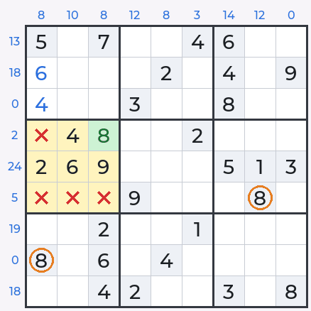

<!-- Written by tools/walkthrough.py sandwich: edit the script, not this page. -->
# Sandwich, step 3: the 8 in box 4

**Step 3 of 53** · [← Step 2](step-02.md) · [All steps](../sandwich.md#the-whole-puzzle-step-by-step) · [Step 4 →](step-04.md)

Box 4 needs an 8. r4c1: column 1 has one (r8c1). r6c1, r6c2 and r6c3: row 6 has one (r6c8). Only **r4c3** is left: **r4c3 = 8**.

**Step 3 of 53** · [← Step 2](step-02.md) · [All steps](../sandwich.md#the-whole-puzzle-step-by-step) · [Step 4 →](step-04.md)
