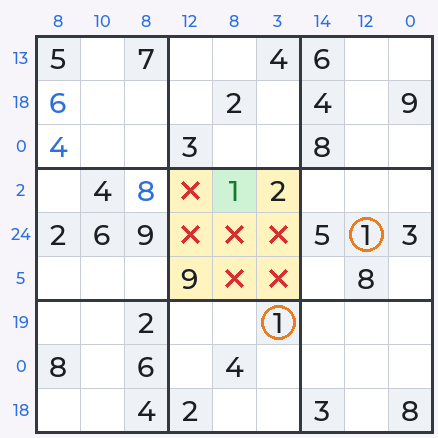

<!-- Written by tools/walkthrough.py sandwich: edit the script, not this page. -->
# Sandwich, step 4: the 1 in box 5

**Step 4 of 53** · [← Step 3](step-03.md) · [All steps](../sandwich.md#the-whole-puzzle-step-by-step) · [Step 5 →](step-05.md)

Box 5 needs a 1. r5c4, r5c5 and r5c6: row 5 has one (r5c8). r6c6: column 6 has one (r7c6). r4c4: column 4's sum is 12: with a 1 there, the digits between its 1 and 9 can't add up to it. r6c5: row 6's sum is 5: with a 1 there, the digits between its 1 and 9 can't add up to it. Only **r4c5** is left: **r4c5 = 1**.

**Step 4 of 53** · [← Step 3](step-03.md) · [All steps](../sandwich.md#the-whole-puzzle-step-by-step) · [Step 5 →](step-05.md)
