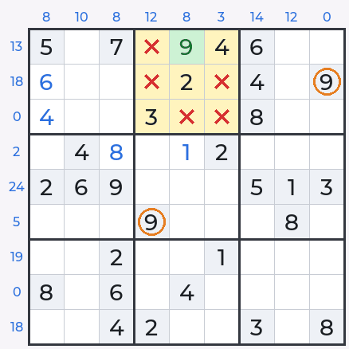

<!-- Written by tools/walkthrough.py sandwich: edit the script, not this page. -->
# Sandwich, step 5: the 9 in box 2

**Step 5 of 53** · [← Step 4](step-04.md) · [All steps](../sandwich.md#the-whole-puzzle-step-by-step) · [Step 6 →](step-06.md)

Box 2 needs a 9. r1c4: column 4 has one (r6c4). r2c4 and r2c6: row 2 has one (r2c9). r3c5: column 5's sum is 8: with a 9 there, the digits between its 1 and 9 can't add up to it. r3c6: column 6's sum is 3: with a 9 there, the digits between its 1 and 9 can't add up to it. Only **r1c5** is left: **r1c5 = 9**.

**Step 5 of 53** · [← Step 4](step-04.md) · [All steps](../sandwich.md#the-whole-puzzle-step-by-step) · [Step 6 →](step-06.md)
