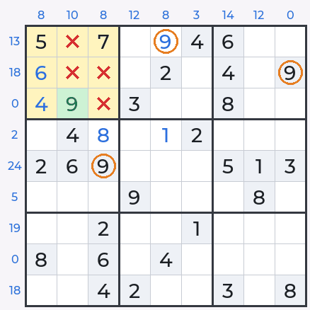

<!-- Written by tools/walkthrough.py sandwich: edit the script, not this page. -->
# Sandwich, step 6: the 9 in box 1

**Step 6 of 53** · [← Step 5](step-05.md) · [All steps](../sandwich.md#the-whole-puzzle-step-by-step) · [Step 7 →](step-07.md)

Box 1 needs a 9. r1c2: row 1 has one (r1c5). r2c2 and r2c3: row 2 has one (r2c9). r3c3: column 3 has one (r5c3). Only **r3c2** is left: **r3c2 = 9**.

**Step 6 of 53** · [← Step 5](step-05.md) · [All steps](../sandwich.md#the-whole-puzzle-step-by-step) · [Step 7 →](step-07.md)
