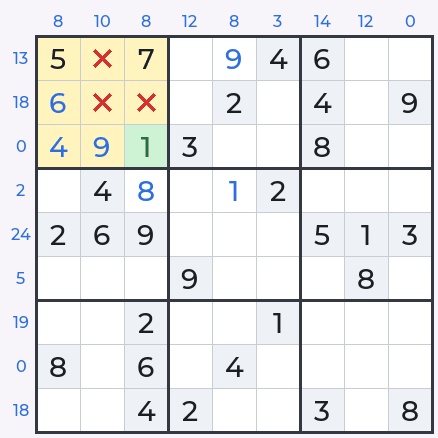

<!-- Written by tools/walkthrough.py sandwich: edit the script, not this page. -->
# Sandwich, step 7: the 1 in box 1

**Step 7 of 53** · [← Step 6](step-06.md) · [All steps](../sandwich.md#the-whole-puzzle-step-by-step) · [Step 8 →](step-08.md)

Box 1 needs a 1. r1c2: column 2's sum is 10: with a 1 there, the digits between its 1 and 9 can't add up to it. r2c2: row 2's sum is 18: with a 1 there, the digits between its 1 and 9 can't add up to it. r2c3: column 3's sum is 8: with a 1 there, the digits between its 1 and 9 can't add up to it. Only **r3c3** is left: **r3c3 = 1**.

**Step 7 of 53** · [← Step 6](step-06.md) · [All steps](../sandwich.md#the-whole-puzzle-step-by-step) · [Step 8 →](step-08.md)
