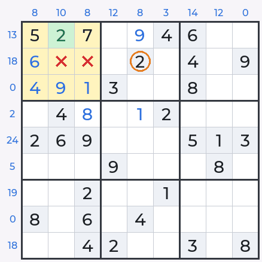

<!-- Written by tools/walkthrough.py sandwich: edit the script, not this page. -->
# Sandwich, step 8: the 2 in box 1

**Step 8 of 53** · [← Step 7](step-07.md) · [All steps](../sandwich.md#the-whole-puzzle-step-by-step) · [Step 9 →](step-09.md)

Box 1 needs a 2. r2c2 and r2c3: row 2 has one (r2c5). Only **r1c2** is left: **r1c2 = 2**.

**Step 8 of 53** · [← Step 7](step-07.md) · [All steps](../sandwich.md#the-whole-puzzle-step-by-step) · [Step 9 →](step-09.md)
