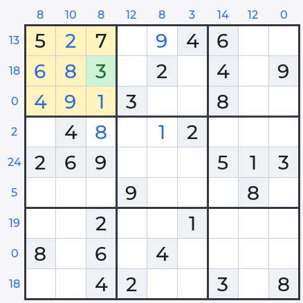

<!-- Written by tools/walkthrough.py sandwich: edit the script, not this page. -->
# Sandwich, step 10: the 3 in box 1

**Step 10 of 53** · [← Step 9](step-09.md) · [All steps](../sandwich.md#the-whole-puzzle-step-by-step) · [Step 11 →](step-11.md)

Box 1 needs a 3, and r2c3 is its last empty cell: **r2c3 = 3**.

**Step 10 of 53** · [← Step 9](step-09.md) · [All steps](../sandwich.md#the-whole-puzzle-step-by-step) · [Step 11 →](step-11.md)
