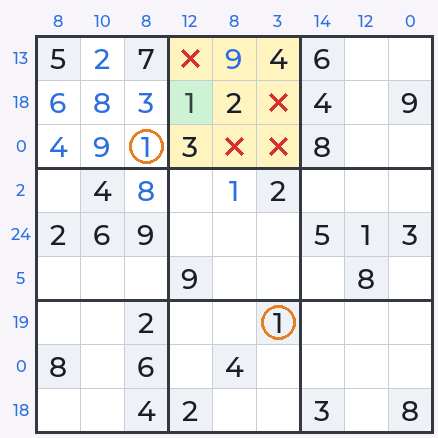

<!-- Written by tools/walkthrough.py sandwich: edit the script, not this page. -->
# Sandwich, step 11: the 1 in box 2

**Step 11 of 53** · [← Step 10](step-10.md) · [All steps](../sandwich.md#the-whole-puzzle-step-by-step) · [Step 12 →](step-12.md)

Box 2 needs a 1. r2c6: column 6 has one (r7c6). r3c5 and r3c6: row 3 has one (r3c3). r1c4: row 1's sum is 13: with a 1 there, the digits between its 1 and 9 can't add up to it. Only **r2c4** is left: **r2c4 = 1**.

**Step 11 of 53** · [← Step 10](step-10.md) · [All steps](../sandwich.md#the-whole-puzzle-step-by-step) · [Step 12 →](step-12.md)
