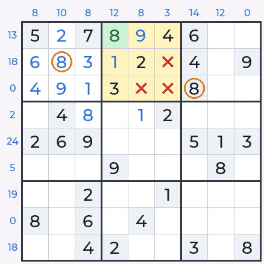

<!-- Written by tools/walkthrough.py sandwich: edit the script, not this page. -->
# Sandwich, step 12: the 8 in box 2

**Step 12 of 53** · [← Step 11](step-11.md) · [All steps](../sandwich.md#the-whole-puzzle-step-by-step) · [Step 13 →](step-13.md)

Box 2 needs an 8. r2c6: row 2 has one (r2c2). r3c5 and r3c6: row 3 has one (r3c7). Only **r1c4** is left: **r1c4 = 8**.

**Step 12 of 53** · [← Step 11](step-11.md) · [All steps](../sandwich.md#the-whole-puzzle-step-by-step) · [Step 13 →](step-13.md)
