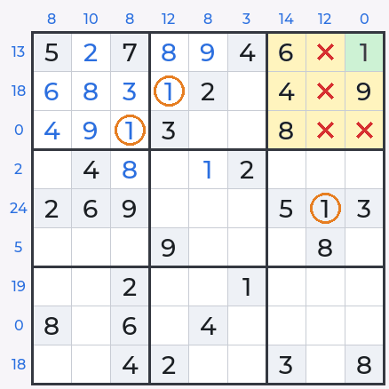

<!-- Written by tools/walkthrough.py sandwich: edit the script, not this page. -->
# Sandwich, step 13: the 1 in box 3

**Step 13 of 53** · [← Step 12](step-12.md) · [All steps](../sandwich.md#the-whole-puzzle-step-by-step) · [Step 14 →](step-14.md)

Box 3 needs a 1. r1c8: column 8 has one (r5c8). r2c8: row 2 has one (r2c4). r3c8 and r3c9: row 3 has one (r3c3). Only **r1c9** is left: **r1c9 = 1**.

**Step 13 of 53** · [← Step 12](step-12.md) · [All steps](../sandwich.md#the-whole-puzzle-step-by-step) · [Step 14 →](step-14.md)
