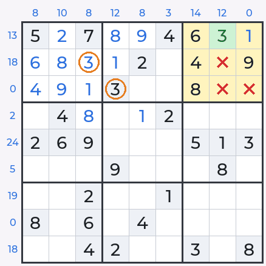

<!-- Written by tools/walkthrough.py sandwich: edit the script, not this page. -->
# Sandwich, step 14: the 3 in box 3

**Step 14 of 53** · [← Step 13](step-13.md) · [All steps](../sandwich.md#the-whole-puzzle-step-by-step) · [Step 15 →](step-15.md)

Box 3 needs a 3. r2c8: row 2 has one (r2c3). r3c8 and r3c9: row 3 has one (r3c4). Only **r1c8** is left: **r1c8 = 3**.

**Step 14 of 53** · [← Step 13](step-13.md) · [All steps](../sandwich.md#the-whole-puzzle-step-by-step) · [Step 15 →](step-15.md)
