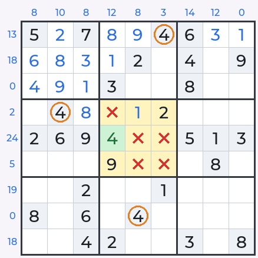

<!-- Written by tools/walkthrough.py sandwich: edit the script, not this page. -->
# Sandwich, step 15: the 4 in box 5

**Step 15 of 53** · [← Step 14](step-14.md) · [All steps](../sandwich.md#the-whole-puzzle-step-by-step) · [Step 16 →](step-16.md)

Box 5 needs a 4. r4c4: row 4 has one (r4c2). r5c5 and r6c5: column 5 has one (r8c5). r5c6 and r6c6: column 6 has one (r1c6). Only **r5c4** is left: **r5c4 = 4**.

**Step 15 of 53** · [← Step 14](step-14.md) · [All steps](../sandwich.md#the-whole-puzzle-step-by-step) · [Step 16 →](step-16.md)
