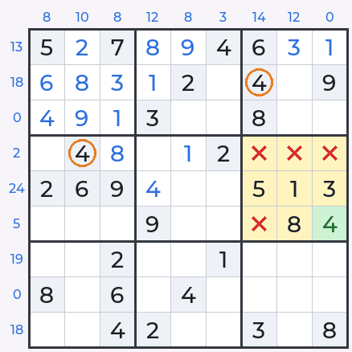

<!-- Written by tools/walkthrough.py sandwich: edit the script, not this page. -->
# Sandwich, step 16: the 4 in box 6

**Step 16 of 53** · [← Step 15](step-15.md) · [All steps](../sandwich.md#the-whole-puzzle-step-by-step) · [Step 17 →](step-17.md)

Box 6 needs a 4. r4c7, r4c8 and r4c9: row 4 has one (r4c2). r6c7: column 7 has one (r2c7). Only **r6c9** is left: **r6c9 = 4**.

**Step 16 of 53** · [← Step 15](step-15.md) · [All steps](../sandwich.md#the-whole-puzzle-step-by-step) · [Step 17 →](step-17.md)
