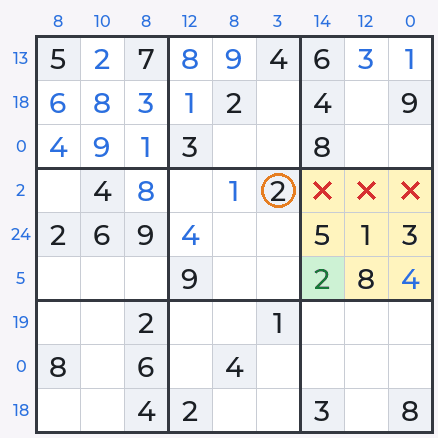

<!-- Written by tools/walkthrough.py sandwich: edit the script, not this page. -->
# Sandwich, step 17: the 2 in box 6

**Step 17 of 53** · [← Step 16](step-16.md) · [All steps](../sandwich.md#the-whole-puzzle-step-by-step) · [Step 18 →](step-18.md)

Box 6 needs a 2. r4c7, r4c8 and r4c9: row 4 has one (r4c6). Only **r6c7** is left: **r6c7 = 2**.

**Step 17 of 53** · [← Step 16](step-16.md) · [All steps](../sandwich.md#the-whole-puzzle-step-by-step) · [Step 18 →](step-18.md)
