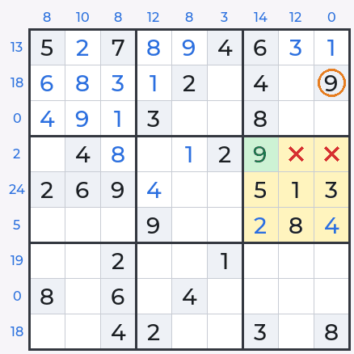

<!-- Written by tools/walkthrough.py sandwich: edit the script, not this page. -->
# Sandwich, step 18: the 9 in box 6

**Step 18 of 53** · [← Step 17](step-17.md) · [All steps](../sandwich.md#the-whole-puzzle-step-by-step) · [Step 19 →](step-19.md)

Box 6 needs a 9. r4c9: column 9 has one (r2c9). r4c8: row 4's sum is 2: with a 9 there, the digits between its 1 and 9 can't add up to it. Only **r4c7** is left: **r4c7 = 9**.

**Step 18 of 53** · [← Step 17](step-17.md) · [All steps](../sandwich.md#the-whole-puzzle-step-by-step) · [Step 19 →](step-19.md)
