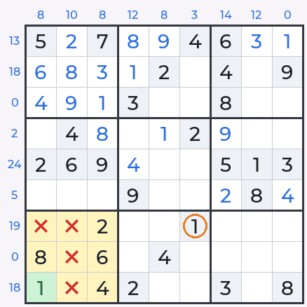

<!-- Written by tools/walkthrough.py sandwich: edit the script, not this page. -->
# Sandwich, step 19: the 1 in box 7

**Step 19 of 53** · [← Step 18](step-18.md) · [All steps](../sandwich.md#the-whole-puzzle-step-by-step) · [Step 20 →](step-20.md)

Box 7 needs a 1. r7c1 and r7c2: row 7 has one (r7c6). r8c2 and r9c2: column 2's sum is 10: with a 1 there, the digits between its 1 and 9 can't add up to it. Only **r9c1** is left: **r9c1 = 1**.

**Step 19 of 53** · [← Step 18](step-18.md) · [All steps](../sandwich.md#the-whole-puzzle-step-by-step) · [Step 20 →](step-20.md)
