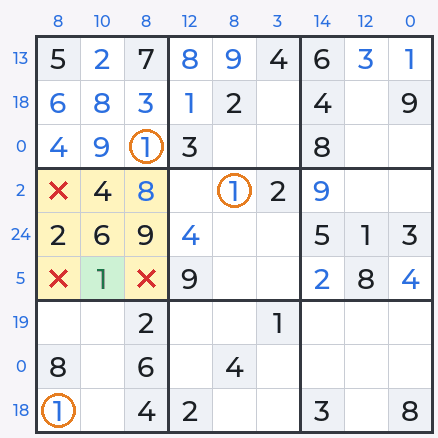

<!-- Written by tools/walkthrough.py sandwich: edit the script, not this page. -->
# Sandwich, step 20: the 1 in box 4

**Step 20 of 53** · [← Step 19](step-19.md) · [All steps](../sandwich.md#the-whole-puzzle-step-by-step) · [Step 21 →](step-21.md)

Box 4 needs a 1. r4c1: row 4 has one (r4c5). r6c1: column 1 has one (r9c1). r6c3: column 3 has one (r3c3). Only **r6c2** is left: **r6c2 = 1**.

**Step 20 of 53** · [← Step 19](step-19.md) · [All steps](../sandwich.md#the-whole-puzzle-step-by-step) · [Step 21 →](step-21.md)
